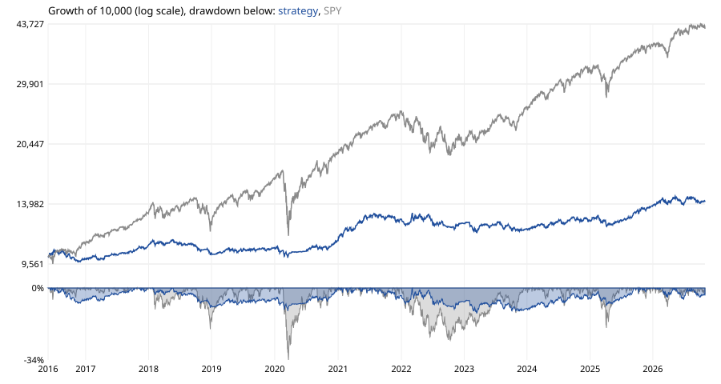

# ladder_ravc_fitted

## Performance

2016-06-01 to 2026-10-30, 2620 sessions chained, zero risk-free rate, 252 sessions a year (CAGR from the session count). Sortino uses downside deviation below 0. Beta and annualized alpha are a CAPM regression of daily returns on SPY, whatever the headline benchmark.

| series | CAGR | Sharpe | Sortino | volatility | max DD | beta vs SPY | alpha vs SPY (annual) |
|---|---|---|---|---|---|---|---|
| strategy | 3.4% | 0.54 | 0.73 | 6.7% | -11.9% | 0.17 | +1.0% |
| SPY | 14.9% | 0.88 | 1.24 | 17.5% | -33.8% | 1.00 | +0.0% |

## Monte Carlo max drawdown

A: path rerun on jointly bootstrapped dates; 200 paths, seed 0, mean block 20.0. Max drawdown is on the one continuous backtest.

| series | historical max DD (pct rank) | DD p5 | p50 | p95 | p99 | P(DD>20/30/50%) | underwater sessions p50 / p95 | terminal return p5 / p50 / p95 |
|---|---|---|---|---|---|---|---|---|
| strategy | 11.9% (22th pct) | 9.2% | 15.3% | 27.4% | 32.6% | 22.0% / 2.5% / 0.0% | 642 / 1792 | 12.7% / 73.8% / 156.0% |
| benchmark (SPY) | 33.8% (60th pct) | 17.0% | 31.6% | 41.7% | 48.9% | 86.0% / 52.5% / 0.5% | 464 / 990 | 106.7% / 333.6% / 822.6% |

## Walk-forward folds

| fold | return | benchmark | max DD | fills |
|---|---|---|---|---|
| 2016-06-01 | 41.65% | 324.16% | -11.9% | 419 |

Trade logs: trades_best_day.md, trades_worst_day.md, trades_random_day.md, trades_all.csv. Full detail (Sharpe, volatility, turnover, cost drag, abstentions, forced closes, execution stress) is in report.json.
