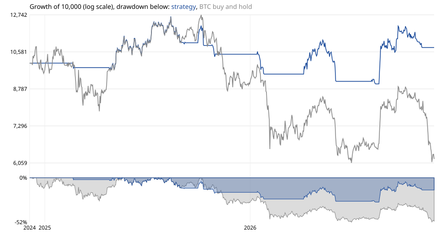

# custom_mom60_BTC

## Performance

2024-12-06 to 2026-11-24, 719 sessions chained, zero risk-free rate, 365 sessions a year (CAGR from the session count). Sortino uses downside deviation below 0. Beta and annualized alpha are a CAPM regression of daily returns on SPY, whatever the headline benchmark.

| series | CAGR | Sharpe | Sortino | volatility | max DD | beta vs SPY | alpha vs SPY (annual) |
|---|---|---|---|---|---|---|---|
| strategy | 4.0% | 0.29 | 0.44 | 22.9% | -28.7% | 0.16 | +5.4% |
| BTC buy and hold | -21.7% | -0.36 | -0.51 | 42.6% | -52.4% | 0.80 | -20.9% |
| SPY | 6.1% | 0.49 | 0.73 | 14.1% | -19.0% | 1.00 | +0.0% |

## Monte Carlo max drawdown

A: path rerun on bootstrapped bars; 1000 paths, seed 0, mean block 20.0. Max drawdown is on the one continuous backtest.

| series | historical max DD (pct rank) | DD p5 | p50 | p95 | p99 | P(DD>20/30/50%) | underwater sessions p50 / p95 | terminal return p5 / p50 / p95 |
|---|---|---|---|---|---|---|---|---|
| strategy | 28.7% (29th pct) | 20.4% | 34.9% | 52.8% | 60.1% | 95.9% / 67.8% / 8.1% | 515 / 655 | -46.3% / -17.8% / 42.0% |
| benchmark (BTC buy and hold) | 52.4% (37th pct) | 33.0% | 57.9% | 79.6% | 85.1% | 99.6% / 97.1% / 68.8% | 590 / 718 | -75.2% / -37.5% / 54.9% |

## Walk-forward folds

| fold | return | benchmark | max DD | fills |
|---|---|---|---|---|
| full period | 8.10% | -38.19% | -28.7% | 33 |

Trade logs: trades_best_day.md, trades_worst_day.md, trades_random_day.md, trades_all.csv. Full detail (Sharpe, volatility, turnover, cost drag, abstentions, forced closes, execution stress) is in report.json.
