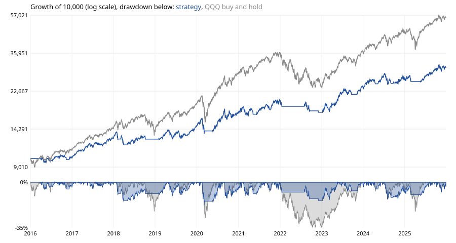

# custom_mom60_QQQ

## Performance

2016-01-05 to 2025-12-31, 2513 sessions chained, zero risk-free rate, 252 sessions a year (CAGR from the session count). Sortino uses downside deviation below 0. Beta and annualized alpha are a CAPM regression of daily returns on SPY, whatever the headline benchmark.

| series | CAGR | Sharpe | Sortino | volatility | max DD | beta vs SPY | alpha vs SPY (annual) |
|---|---|---|---|---|---|---|---|
| strategy | 11.7% | 0.84 | 1.15 | 14.3% | -17.8% | 0.46 | +5.7% |
| QQQ buy and hold | 18.7% | 0.89 | 1.26 | 21.9% | -35.2% | 1.14 | +3.7% |
| SPY | 13.0% | 0.78 | 1.09 | 17.8% | -34.2% | 1.00 | +0.0% |

## Monte Carlo max drawdown

A: path rerun on bootstrapped bars; 1000 paths, seed 0, mean block 20.0. Max drawdown is on the one continuous backtest.

| series | historical max DD (pct rank) | DD p5 | p50 | p95 | p99 | P(DD>20/30/50%) | underwater sessions p50 / p95 | terminal return p5 / p50 / p95 |
|---|---|---|---|---|---|---|---|---|
| strategy | 17.8% (4th pct) | 18.0% | 27.5% | 43.1% | 50.1% | 88.1% / 36.9% / 1.1% | 683 / 1698 | 12.4% / 167.6% / 546.1% |
| benchmark (QQQ buy and hold) | 35.2% (67th pct) | 22.2% | 31.9% | 46.6% | 54.7% | 98.0% / 58.5% / 2.8% | 452 / 1085 | 105.1% / 458.9% / 1262.8% |

## Walk-forward folds

| fold | return | benchmark | max DD | fills |
|---|---|---|---|---|
| full period | 201.02% | 451.11% | -17.8% | 96 |

Trade logs: trades_best_day.md, trades_worst_day.md, trades_random_day.md, trades_all.csv. Full detail (Sharpe, volatility, turnover, cost drag, abstentions, forced closes, execution stress) is in report.json.
