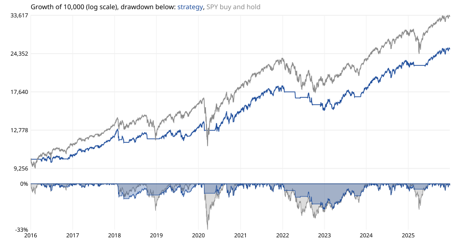

# custom_mom60_SPY

## Performance

2016-01-05 to 2025-12-31, 2513 sessions chained, zero risk-free rate, 252 sessions a year (CAGR from the session count). Sortino uses downside deviation below 0. Beta and annualized alpha are a CAPM regression of daily returns on SPY, whatever the headline benchmark.

| series | CAGR | Sharpe | Sortino | volatility | max DD | beta vs SPY | alpha vs SPY (annual) |
|---|---|---|---|---|---|---|---|
| strategy | 9.7% | 0.93 | 1.26 | 10.6% | -18.9% | 0.37 | +4.8% |
| SPY buy and hold | 12.8% | 0.78 | 1.10 | 17.3% | -33.2% | 0.97 | +0.1% |
| SPY | 13.0% | 0.78 | 1.09 | 17.8% | -34.2% | 1.00 | +0.0% |

## Monte Carlo max drawdown

A: path rerun on bootstrapped bars; 1000 paths, seed 0, mean block 20.0. Max drawdown is on the one continuous backtest.

| series | historical max DD (pct rank) | DD p5 | p50 | p95 | p99 | P(DD>20/30/50%) | underwater sessions p50 / p95 | terminal return p5 / p50 / p95 |
|---|---|---|---|---|---|---|---|---|
| strategy | 18.9% (29th pct) | 14.5% | 21.8% | 35.5% | 42.5% | 63.2% / 14.2% / 0.0% | 688 / 1737 | 11.5% / 104.2% / 288.6% |
| benchmark (SPY buy and hold) | 33.2% (54th pct) | 18.0% | 31.8% | 46.6% | 54.2% | 89.6% / 55.4% / 2.6% | 507 / 1257 | 50.8% / 236.4% / 583.0% |

## Walk-forward folds

| fold | return | benchmark | max DD | fills |
|---|---|---|---|---|
| full period | 152.39% | 232.11% | -18.9% | 93 |

Trade logs: trades_best_day.md, trades_worst_day.md, trades_random_day.md, trades_all.csv. Full detail (Sharpe, volatility, turnover, cost drag, abstentions, forced closes, execution stress) is in report.json.
