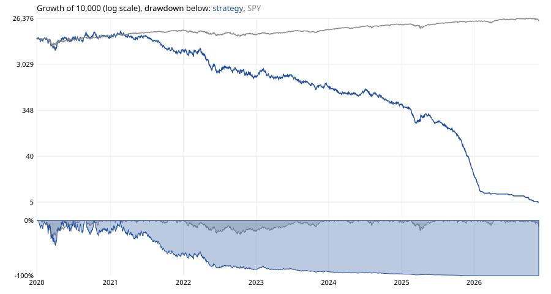

# intraday-orb long_only_2bps

## Performance

2020-01-02 to 2026-11-20, 1732 sessions chained, zero risk-free rate, 252 sessions a year (CAGR from the session count). Sortino uses downside deviation below 0. Beta and annualized alpha are a CAPM regression of daily returns on SPY, whatever the headline benchmark.

| series | CAGR | Sharpe | Sortino | volatility | max DD | beta vs SPY | alpha vs SPY (annual) |
|---|---|---|---|---|---|---|---|
| strategy | -67.3% | -1.49 | -2.19 | 62.2% | -100.0% | 1.71 | -117.2% |
| SPY | 13.1% | 0.72 | 1.02 | 19.8% | -33.8% | 1.00 | +0.0% |

## Monte Carlo max drawdown

B: block bootstrap of the daily returns; 1000 paths, seed 0, mean block 20.0. Max drawdown is on the one continuous backtest.

| series | historical max DD (pct rank) | DD p5 | p50 | p95 | p99 | P(DD>20/30/50%) | underwater sessions p50 / p95 | terminal return p5 / p50 / p95 |
|---|---|---|---|---|---|---|---|---|
| strategy | 100.0% (54th pct) | 99.3% | 100.0% | 100.0% | 100.0% | 100.0% / 100.0% / 100.0% | 1718 / 1732 | -100.0% / -99.9% / -99.1% |
| benchmark (SPY) | 33.8% (51th pct) | 17.9% | 33.8% | 50.5% | 61.7% | 90.9% / 61.6% / 5.3% | 458 / 1211 | 7.0% / 127.9% / 375.5% |

## Walk-forward folds

| fold | return | benchmark | max DD | fills |
|---|---|---|---|---|
| full period | -99.95% | 133.53% | -100.0% | 21006 |

Trade logs: trades_best_day.md, trades_worst_day.md, trades_random_day.md, trades_all.csv. Full detail (Sharpe, volatility, turnover, cost drag, abstentions, forced closes, execution stress) is in report.json.
