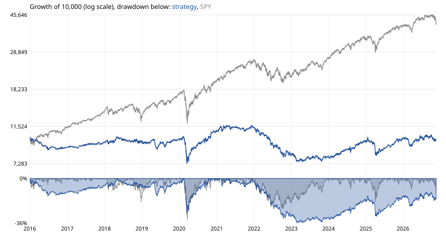

# intraday-overnight QQQ_overnight_2bps

## Performance

2016-01-04 to 2026-11-20, 2738 sessions chained, zero risk-free rate, 252 sessions a year (CAGR from the session count). Sortino uses downside deviation below 0. Beta and annualized alpha are a CAPM regression of daily returns on SPY, whatever the headline benchmark.

| series | CAGR | Sharpe | Sortino | volatility | max DD | beta vs SPY | alpha vs SPY (annual) |
|---|---|---|---|---|---|---|---|
| strategy | -0.2% | 0.05 | 0.07 | 13.6% | -36.3% | 0.48 | -6.2% |
| SPY | 13.7% | 0.82 | 1.15 | 17.5% | -33.8% | 1.00 | +0.0% |

## Monte Carlo max drawdown

B: block bootstrap of the daily returns; 1000 paths, seed 0, mean block 20.0. Max drawdown is on the one continuous backtest.

| series | historical max DD (pct rank) | DD p5 | p50 | p95 | p99 | P(DD>20/30/50%) | underwater sessions p50 / p95 | terminal return p5 / p50 / p95 |
|---|---|---|---|---|---|---|---|---|
| strategy | 36.3% (46th pct) | 21.0% | 37.7% | 61.5% | 69.3% | 96.0% / 73.1% / 21.8% | 1687 / 2716 | -50.7% / -0.4% / 88.2% |
| benchmark (SPY) | 33.8% (59th pct) | 19.3% | 32.0% | 48.1% | 57.1% | 93.0% / 57.0% / 3.3% | 530 / 1313 | 79.9% / 309.6% / 845.8% |

## Walk-forward folds

| fold | return | benchmark | max DD | fills |
|---|---|---|---|---|
| full period | -2.26% | 304.15% | -36.3% | 5474 |

Trade logs: trades_best_day.md, trades_worst_day.md, trades_random_day.md, trades_all.csv. Full detail (Sharpe, volatility, turnover, cost drag, abstentions, forced closes, execution stress) is in report.json.
