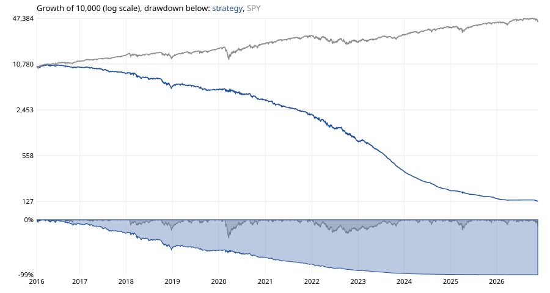

# intraday-overnight stocks20_intraday_mirror_2bps

## Performance

2016-02-01 to 2026-11-20, 2719 sessions chained, zero risk-free rate, 252 sessions a year (CAGR from the session count). Sortino uses downside deviation below 0. Beta and annualized alpha are a CAPM regression of daily returns on SPY, whatever the headline benchmark.

| series | CAGR | Sharpe | Sortino | volatility | max DD | beta vs SPY | alpha vs SPY (annual) |
|---|---|---|---|---|---|---|---|
| strategy | -33.3% | -3.01 | -3.67 | 13.1% | -98.8% | 0.48 | -46.6% |
| SPY | 14.2% | 0.85 | 1.19 | 17.5% | -33.8% | 1.00 | +0.0% |

## Monte Carlo max drawdown

B: block bootstrap of the daily returns; 1000 paths, seed 0, mean block 20.0. Max drawdown is on the one continuous backtest.

| series | historical max DD (pct rank) | DD p5 | p50 | p95 | p99 | P(DD>20/30/50%) | underwater sessions p50 / p95 | terminal return p5 / p50 / p95 |
|---|---|---|---|---|---|---|---|---|
| strategy | 98.8% (54th pct) | 97.1% | 98.7% | 99.5% | 99.6% | 100.0% / 100.0% / 100.0% | 2716 / 2719 | -99.5% / -98.7% / -97.1% |
| benchmark (SPY) | 33.8% (61th pct) | 18.5% | 31.9% | 45.7% | 55.2% | 90.8% / 57.5% / 2.8% | 504 / 1222 | 90.8% / 329.8% / 832.8% |

## Walk-forward folds

| fold | return | benchmark | max DD | fills |
|---|---|---|---|---|
| full period | -98.73% | 319.54% | -98.8% | 77166 |

Trade logs: trades_best_day.md, trades_worst_day.md, trades_random_day.md, trades_all.csv. Full detail (Sharpe, volatility, turnover, cost drag, abstentions, forced closes, execution stress) is in report.json.
