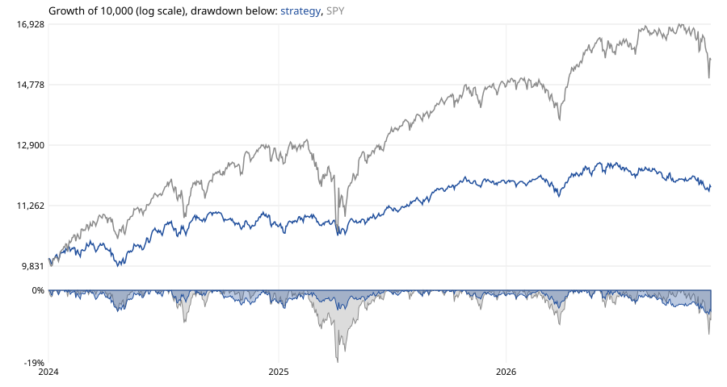

# holdout

## Performance

2024-01-02 to 2026-11-24, 728 sessions chained, zero risk-free rate, 252 sessions a year (CAGR from the session count). Sortino uses downside deviation below 0. Beta and annualized alpha are a CAPM regression of daily returns on SPY, whatever the headline benchmark.

| series | CAGR | Sharpe | Sortino | volatility | max DD | beta vs SPY | alpha vs SPY (annual) |
|---|---|---|---|---|---|---|---|
| strategy | 5.7% | 0.76 | 1.10 | 7.7% | -6.2% | 0.34 | +0.1% |
| SPY | 16.7% | 1.04 | 1.53 | 16.1% | -18.8% | 1.00 | +0.0% |

## Monte Carlo max drawdown

A: path rerun on jointly bootstrapped dates; 1000 paths, seed 0, mean block 20.0. Max drawdown is on the one continuous backtest.

| series | historical max DD (pct rank) | DD p5 | p50 | p95 | p99 | P(DD>20/30/50%) | underwater sessions p50 / p95 | terminal return p5 / p50 / p95 |
|---|---|---|---|---|---|---|---|---|
| strategy | 6.2% (8th pct) | 5.9% | 8.9% | 15.7% | 19.7% | 0.9% / 0.0% / 0.0% | 210 / 534 | 2.2% / 28.0% / 61.3% |
| benchmark (SPY) | 18.8% (76th pct) | 8.5% | 14.8% | 25.1% | 33.3% | 17.9% / 1.8% / 0.0% | 160 / 444 | 12.8% / 63.4% / 132.7% |

## Walk-forward folds

| fold | return | benchmark | max DD | fills |
|---|---|---|---|---|
| 2024-01-02 | 17.36% | 56.18% | -6.2% | 306 |

Trade logs: trades_best_day.md, trades_worst_day.md, trades_random_day.md, trades_all.csv. Full detail (Sharpe, volatility, turnover, cost drag, abstentions, forced closes, execution stress) is in report.json.
