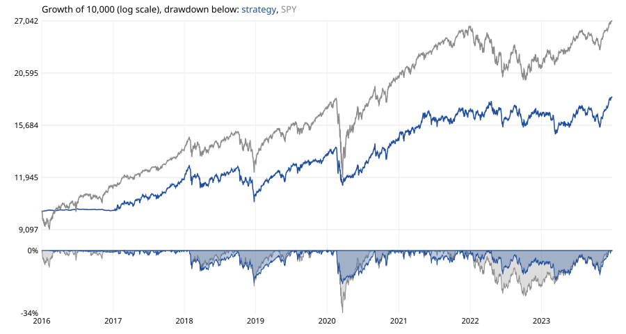

# insample

## Performance

2016-01-05 to 2023-12-29, 2011 sessions chained, zero risk-free rate, 252 sessions a year (CAGR from the session count). Sortino uses downside deviation below 0. Beta and annualized alpha are a CAPM regression of daily returns on SPY, whatever the headline benchmark.

| series | CAGR | Sharpe | Sortino | volatility | max DD | beta vs SPY | alpha vs SPY (annual) |
|---|---|---|---|---|---|---|---|
| strategy | 7.7% | 0.65 | 0.88 | 12.8% | -18.1% | 0.57 | +0.3% |
| SPY | 13.2% | 0.78 | 1.08 | 18.1% | -33.8% | 1.00 | +0.0% |

## Monte Carlo max drawdown

A: path rerun on jointly bootstrapped dates; 200 paths, seed 0, mean block 20.0. Max drawdown is on the one continuous backtest.

| series | historical max DD (pct rank) | DD p5 | p50 | p95 | p99 | P(DD>20/30/50%) | underwater sessions p50 / p95 | terminal return p5 / p50 / p95 |
|---|---|---|---|---|---|---|---|---|
| strategy | 18.1% (24th pct) | 14.1% | 22.6% | 34.2% | 50.4% | 64.5% / 16.5% / 1.5% | 482 / 1297 | 2.2% / 87.8% / 226.0% |
| benchmark (SPY) | 33.8% (58th pct) | 16.6% | 30.9% | 50.8% | 57.9% | 89.0% / 53.5% / 5.5% | 468 / 1159 | 14.1% / 166.9% / 411.0% |

## Walk-forward folds

| fold | return | benchmark | max DD | fills |
|---|---|---|---|---|
| 2016-01-05 | 81.12% | 169.64% | -18.1% | 1729 |

Trade logs: trades_best_day.md, trades_worst_day.md, trades_random_day.md, trades_all.csv. Full detail (Sharpe, volatility, turnover, cost drag, abstentions, forced closes, execution stress) is in report.json.
